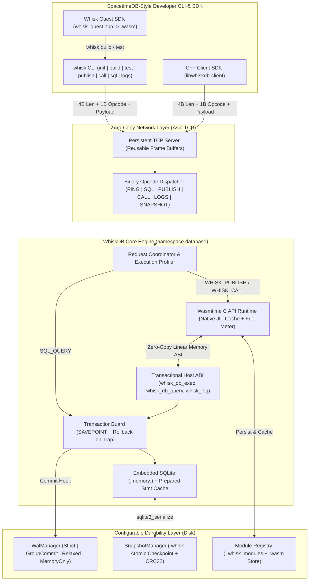

# WhiskDB — Graduation Project Master Plan & GitHub Issue Roadmap

> [!NOTE]
> **Academic Context:** YZL 400 Senior Capstone Graduation Project at **OSTİM Technical University**  
> **Team:** Abdullah Al Tamsha (`230208916`), Ibrahim Jamil Karaja (`230208879`), Rashid Alkatheri (`230208843`)  
> **Target Environment:** C++23 on Ubuntu 24.04+ & Debian Trixie (`x86_64`)  
> **Engineering Rules:** See [AGENTS.md](AGENTS.md) and [docs/developer-guide.md](docs/developer-guide.md) (DuckDB-inspired C++23 standards)

---

## 1. Core Architectural Pillars

### 1.1 SpacetimeDB-Style Developer Workflow
WhiskDB gives developers a complete, ergonomic workflow to write, test, publish, and invoke server-side C++ functions (**Whisks**) compiled to WebAssembly:
- **`whisk init <project>`**: Scaffolds a Whisk C++ project (`whisk_guest.hpp`, sample Whisk module, and CMake/Clang WASM build script).
- **`whisk build`**: Compiles C++ source into deterministic `.wasm` bytecode (`wasm32`).
- **`whisk test`**: Runs the compiled `.wasm` module locally in an ephemeral `memory_only` WhiskDB instance to verify tables and assertions before pushing.
- **`whisk publish <module> <file.wasm>`**: Uploads and hot-reloads the `.wasm` module into WhiskDB. Automatically runs the module's `__init__` (first deploy) or `__update__` (schema migration) lifecycle hook inside an atomic transaction.
- **`whisk call <module> <func> [json_args]`**: Invokes an exported Whisk function inside the database host transactionally.
- **`whisk sql "<query>"`**: Runs standard relational SQL queries against the database.
- **`whisk logs`**: Streams or fetches structured execution logs emitted by `whisk::log()` inside WASM modules.

---

### 1.2 Flexible Reliability & Durability Modes (`DurabilityMode`)
To compete with real-world in-memory systems like **SpacetimeDB** and **DuckDB** while supporting different deployment guarantees, WhiskDB provides 4 configurable durability modes in `config.toml` (and per-session overrides):

| Mode | Mechanism | Latency / Throughput | Guarantee |
|---|---|---|---|
| **`strict` (`SYNC`)** | Append WAL + immediate `fdatasync()` before replying to client | ~100–500 µs | Zero data loss on process, OS, or power crash. |
| **`group_commit` (`BATCHED`, Default)** | Append to lock-free/mutex WAL ring buffer; flush + `fdatasync()` in micro-batches (every 2 ms or 64 commits) | ~10–30 µs (100k+ TPS) | SpacetimeDB-style throughput; at most 2 ms window on sudden power loss, zero loss on process crash. |
| **`relaxed` (`ASYNC`)** | Write WAL record to OS page cache (`write()`), periodic background `fdatasync()` | < 10 µs | Survives database process crash; maximum single-client write speed. |
| **`memory_only` (`EPHEMERAL`)** | Bypass WAL disk I/O completely; pure `:memory:` execution | < 3 µs | Ideal for `whisk test`, ephemeral workloads, and raw compute benchmarks. |

---

### 1.3 DuckDB-Inspired High-Performance C++23 Design
Following **DuckDB**'s engineering philosophy ([docs/developer-guide.md](docs/developer-guide.md) & [AGENTS.md](AGENTS.md)):
1. **Strict `namespace database` & Types:** Fixed-width integers (`uint32_t`, `int64_t`), `idx_t` for all indices/counts, `std::unique_ptr` ownership, `PascalCase` methods/types, `snake_case` files/variables, and `D_ASSERT` with explanatory comments everywhere.
2. **Zero-Copy Hot Paths:** Use `std::string_view` and `std::span<const uint8_t>` across TCP framing, wire protocol parsing, WAL buffer appends, and Wasmtime linear memory reads/writes. Reuse per-session buffers to avoid heap allocations per request.
3. **Prepared Statement & Wasmtime Caching:**
   - SQL statements executed by Whisks (`whisk_db_exec` / `whisk_db_query`) are cached as compiled `sqlite3_stmt*` handles keyed by 64-bit SQL hash—eliminating repeated SQL lexer/parser overhead.
   - `.wasm` modules are pre-compiled to native machine code (`wasmtime_module_t`) upon `whisk publish` so `whisk call` executes native x86_64 JIT/AOT code with microsecond startup.

---

### 1.4 System Architecture Diagram

---

## 2. Strict Testing, CI & Documentation Rules

1. **Nothing Breaks Policy (CI Gate on `dev` and `main`):**
   - **Unit + Negative Tests:** Every PR must include tests for happy paths, boundary conditions, and expected error returns (`Result<T>`) + exception paths (`FatalError`).
   - **Sanitizers & Static Analysis:** GitHub Actions runs Debug builds with `ASAN` + `UBSAN`, `-Wall -Wextra -Werror`, and `clang-tidy` on Ubuntu 24.04 `x86_64`.
   - **Deterministic Crash & Trap Tests:** Automated tests verify that WASM traps/infinite loops roll back partial table mutations and that torn WAL tails recover cleanly.
2. **Concise MkDocs Policy (`docs/`):**
   - Keep `docs/index.md`, `docs/development.md`, `docs/developer-guide.md`, and `docs/user-guide.md` **short, accurate, and to the point**.
   - Never overwrite existing sections unnecessarily—update only the relevant tables/commands as features land.

---

## 3. Complete Milestones & Granular Issue Roadmap (34 Issues)

### Milestone 1: M1 — Core Foundation, DuckDB Conventions & CI (`area:core`, `area:ci-docs`)
*Goal: Establish the C++23 build pipeline on Ubuntu 24+/Debian Trixie, enforce `namespace database` & `D_ASSERT` conventions, error handling, logging, configuration, and sanitizer CI.*

| Issue # | Title | Labels | Status / Source | Summary & Acceptance Criteria |
|---|---|---|---|---|
| **#1** | **Error Handling Framework (`Result<T>`, `D_ASSERT`, `FatalError`)** | `area:core`, `type:feature`, `priority:high` | Open on GitHub (Code in repo) | Implement 3-tier error policy in `include/errors.hpp` & `src/common/errors.cpp` inside `namespace database`: `ErrorCode`, `Error`, `Result<T>` for expected errors, `D_ASSERT` with context comments for bugs, and `FatalError` for fatal failures, plus unit tests. |
| **#2** | **Thread-Safe Structured Logger & In-Memory Log Ring Buffer** | `area:core`, `type:feature`, `priority:high` | Open on GitHub (Code in repo) | Implement `include/logger.hpp` & `src/common/logger.cpp` (`namespace database`) with log levels, `std::format`, thread safety, and a bounded ring buffer so `whisk logs` can fetch recent server/Whisk logs. |
| **#3** | **CMake Build System, `idx_t` Core Types, TOML Config & `dev` Branch Setup** | `area:core`, `type:feature`, `priority:high` | Ready in repo (`config.hpp`, `CMakeLists.txt`) | Configure C++23 `CMakeLists.txt`, `vcpkg.json`, `idx_t` type definitions, and `database::Config` (`config.toml`) including `durability_mode` (`strict`, `group_commit`, `relaxed`, `memory_only`) and WASM fuel limits. |
| **#4** | **GitHub Actions CI (Ubuntu 24.04 + ASAN/UBSAN + `clang-tidy`) & Issue/PR Templates** | `area:ci-docs`, `type:feature`, `priority:high` | New Issue | Add `.github/workflows/ci.yml` running Debug + ASAN/UBSAN builds and `ctest` on every PR targeting `dev`/`main`. Add `.github/ISSUE_TEMPLATE/` and `.github/pull_request_template.md`. |

---

### Milestone 2: M2 — Zero-Copy TCP Networking & Wire Protocol (`area:network`)
*Goal: High-throughput persistent TCP connections with reusable buffers, 4-byte length framing, and binary opcode dispatching.*

| Issue # | Title | Labels | Status / Source | Summary & Acceptance Criteria |
|---|---|---|---|---|
| **#5** | **Zero-Copy Length-Prefixed Wire Framing (`Framing`)** | `area:network`, `type:feature`, `priority:high` | Ready in repo (`include/framing.hpp`) | Implement 4-byte big-endian length header encode/decode using `std::span<const uint8_t>` and `std::string_view`, `MAX_PAYLOAD_SIZE` checks, and unit tests. |
| **#6** | **Asynchronous TCP Server, Reusable Session Buffers & Connection Manager** | `area:network`, `type:feature`, `priority:high` | Ready in repo (`network.cpp`, `tcp_session.cpp`, `connection_manager.cpp`) | Implement `database::Server`, `TcpSession` (with pre-allocated reusable read/write buffers), and `ConnectionManager` using standalone `asio`. |
| **#7** | **Low-Level Persistent TCP Client Transport (`TcpClient`)** | `area:network`, `type:feature`, `priority:medium` | Ready in repo (`include/tcp_client.hpp`, `app/client.cpp`) | Implement `database::TcpClient` supporting persistent socket reuse, sequential framing, and clean disconnect/error recovery. |
| **#8** | **WhiskDB Binary Wire Protocol & Opcode Dispatcher (`Protocol`)** | `area:network`, `type:feature`, `priority:high` | New Issue | Define 1-byte `Opcode` (`PING = 0x01`, `SQL_QUERY = 0x02`, `WHISK_PUBLISH = 0x03`, `WHISK_CALL = 0x04`, `WHISK_LIST = 0x05`, `WHISK_LOGS = 0x06`, `SNAPSHOT = 0x07`) and fast JSON/binary request-response serialization with execution time metrics (`exec_us`). |
| **#9** | **Network Stress & Protocol Fuzz/Boundary Test Suite** | `area:network`, `type:test`, `priority:high` | New Issue | Automated tests verifying 50+ concurrent clients, 10,000 pipelined requests on a single socket, partial TCP reads, oversized frame rejection, and invalid opcodes under ASAN. |

---

### Milestone 3: M3 — In-Memory Relational Engine & Prepared Statement Cache (`area:sql`)
*Goal: Embed SQLite `:memory:` inside WhiskDB with prepared statement caching, savepoint transactions, and catalog metadata.*

| Issue # | Title | Labels | Status / Source | Summary & Acceptance Criteria |
|---|---|---|---|---|
| **#10** | **SQLite3 `:memory:` Integration & RAII Engine Wrapper (`SqlEngine`)** | `area:sql`, `type:feature`, `priority:high` | New Issue | Integrate `sqlite3` in CMake, implement `database::SqlEngine` managing an in-memory instance with tuned pragmas (`foreign_keys=ON`, `temp_store=MEMORY`) and reader/writer synchronization. |
| **#11** | **Fast SQL Executor & Structured Result Serializer** | `area:sql`, `type:feature`, `priority:high` | New Issue | Execute DDL/DML/DQL (`CREATE TABLE`, `INDEX`, `INSERT`, `SELECT`, `UPDATE`, `DELETE`, `JOIN`), extract typed columns (`INT64`, `DOUBLE`, `TEXT`, `BLOB`, `NULL`), and serialize compact result sets. |
| **#12** | **Prepared Statement Cache (`StatementCache`) for Hot Queries** | `area:sql`, `type:feature`, `priority:high` | New Issue | Implement an LRU cache of compiled `sqlite3_stmt*` handles keyed by `std::string_view` hash with parameter binding (`sqlite3_bind_*` + `sqlite3_reset`) for zero-reparse SQL execution inside Whisks. |
| **#13** | **Nested Savepoint Transaction Manager (`TransactionGuard`)** | `area:sql`, `type:feature`, `priority:high` | New Issue | Implement RAII `TransactionGuard` (`SAVEPOINT` / `RELEASE` / `ROLLBACK TO`) ensuring atomic execution and instant rollback on error or trap. |
| **#14** | **System Catalog Tables (`_whisk_modules`, `_whisk_migrations`)** | `area:sql`, `type:feature`, `priority:medium` | New Issue | Maintain internal metadata tables storing deployed Whisk modules (name, version, SHA-256 hash, `.wasm` size, deployed timestamp) and schema state. |

---

### Milestone 4: M4 — Flexible Durability Layer: Multi-Mode WAL & Snapshots (`area:storage`)
*Goal: Achieve SpacetimeDB-level write performance with configurable `DurabilityMode` (`strict`, `group_commit`, `relaxed`, `memory_only`) and atomic `.whisk` snapshots.*

| Issue # | Title | Labels | Status / Source | Summary & Acceptance Criteria |
|---|---|---|---|---|
| **#15** | **Binary Write-Ahead Log Format & Writer (`WalManager`)** | `area:storage`, `type:feature`, `priority:high` | New Issue | Implement binary WAL records (`[LSN (8B) | Timestamp (8B) | Type (1B) | Len (4B) | Payload | CRC32 (4B)]`) with pre-allocated serialization buffers. |
| **#16** | **Flexible Durability Modes & Group-Commit Flush Worker** | `area:storage`, `type:feature`, `priority:high` | New Issue | Implement `DurabilityMode::Strict` (per-tx `fdatasync`), `DurabilityMode::GroupCommit` (batched ring-buffer flush thread), `DurabilityMode::Relaxed` (OS cache write), and `DurabilityMode::MemoryOnly`. |
| **#17** | **WAL Reader, CRC32 Verifier & Deterministic Startup Replay** | `area:storage`, `type:feature`, `priority:high` | New Issue | Scan `whiskdb.wal` on startup, verify CRC32 checksums, safely truncate incomplete tail records from hard crashes, and replay committed SQL/Whisk mutations in LSN order. |
| **#18** | **Atomic In-Memory Snapshot Serializer & Loader (`SnapshotManager`)** | `area:storage`, `type:feature`, `priority:high` | New Issue | Use `sqlite3_serialize` / `sqlite3_deserialize` with a `.whisk` header (`WHSK` magic, version, snapshot LSN, CRC32) written atomically via temp-file + `fdatasync` + `rename` and WAL truncation. |
| **#19** | **Durability, Group-Commit Throughput & Crash Recovery Test Suite** | `area:storage`, `type:test`, `priority:high` | New Issue | Tests verifying all 4 durability modes, bit-flip corruption detection, torn-write recovery, and snapshot + incremental WAL replay. |

---

### Milestone 5: M5 — Wasmtime Engine, Lifecycle Hooks & Transactional Host ABI (`area:wasm`)
*Goal: Run C++-compiled `.wasm` Whisks at near-native speed via `libwasmtime` with deterministic fuel limits, lifecycle hooks (`__init__`/`__update__`), and transactional Host ABI.*

| Issue # | Title | Labels | Status / Source | Summary & Acceptance Criteria |
|---|---|---|---|---|
| **#20** | **Wasmtime C API Integration & `WasmRuntime` Engine** | `area:wasm`, `type:feature`, `priority:high` | New Issue | Integrate `libwasmtime` for Linux `x86_64` (Ubuntu 24+/Debian Trixie). Implement `database::WasmRuntime` configuring JIT compilation, epoch/fuel interruption, and bounded linear memory. |
| **#21** | **Pre-Compiled Module Registry, Hot-Reload & Lifecycle Hooks (`__init__`, `__update__`)** | `area:wasm`, `type:feature`, `priority:high` | New Issue | Compile `.wasm` bytes once into cached `wasmtime_module_t` objects. On `whisk publish`, atomically execute exported `__init__` (new module, e.g., `CREATE TABLE`) or `__update__` (hot-reload upgrade) hooks before committing the module registration. |
| **#22** | **High-Speed Transactional Host ABI (`whisk_db_*` Imports)** | `area:wasm`, `type:feature`, `priority:high` | New Issue | Bind host functions via `wasmtime_linker_define_func`: `whisk_db_exec`, `whisk_db_query`, `whisk_db_prepare` / `whisk_db_step` (fast parameterized execution), and `whisk_log`, with strict linear-memory bounds checking. |
| **#23** | **Atomic Whisk Call Coordinator (Auto-Commit / Auto-Rollback on Trap)** | `area:wasm`, `type:feature`, `priority:high` | New Issue | Execute every `WHISK_CALL` inside a `TransactionGuard` savepoint: pass JSON/binary arguments to guest memory, invoke the target Whisk, append to WAL on success (`0`), or rollback all table mutations if the Whisk returns an error, traps, or exhausts fuel. |
| **#24** | **C++ Whisk Guest SDK (`include/sdk/whisk_guest.hpp`)** | `area:wasm`, `type:feature`, `priority:high` | New Issue | Create a zero-dependency C++ header SDK for writing Whisks: macros (`WHISK_INIT`, `WHISK_UPDATE`, `WHISK_FUNC`), ergonomic wrappers (`whisk::exec()`, `whisk::query()`, `whisk::log()`), and bump allocator for guest args/results. |
| **#25** | **WASM Sandbox Safety, Trap Rollback & Fuel Exhaustion Tests** | `area:wasm`, `type:test`, `priority:high` | New Issue | Strict tests proving: (1) `__init__` creates schema on publish, (2) valid Whisk commits mutations, (3) mid-transaction `unreachable` trap rolls back prior `INSERT`s, and (4) `while(true){}` aborts cleanly on fuel exhaustion. |

---

### Milestone 6: M6 — SpacetimeDB-Style Developer CLI (`whisk`) & C++ Client SDK (`area:client-sdk`, `area:cli`)
*Goal: Provide the `whisk` developer CLI (`init`, `build`, `test`, `publish`, `call`, `sql`, `logs`) and `libwhiskdb-client` C++ SDK.*

| Issue # | Title | Labels | Status / Source | Summary & Acceptance Criteria |
|---|---|---|---|---|
| **#26** | **C++23 Client SDK (`WhiskClient`)** | `area:client-sdk`, `type:feature`, `priority:high` | New Issue | Implement `database::WhiskClient` in `include/client/whisk_client.hpp` with `Connect()`, `Ping()`, `Query(sql)`, `PublishWhisk(name, wasm_bytes)`, `CallWhisk(module, func, args)`, `GetLogs()`, and `Snapshot()`. |
| **#27** | **Interactive & Command-Driven CLI (`whisk sql`, `whisk call`, `whisk logs`)** | `area:cli`, `type:feature`, `priority:high` | New Issue | Build the `whisk` CLI tool supporting both subcommands (`whisk sql`, `whisk call`, `whisk publish`, `whisk logs`, `whisk ping`) and an interactive REPL with ASCII box-drawing tables and microsecond latency readouts. |
| **#28** | **Developer Module Workflow (`whisk init`, `whisk build`, `whisk test`)** | `area:cli`, `type:feature`, `priority:high` | New Issue | Implement `whisk init <dir>` (scaffolds a C++ Whisk module), `whisk build` (invokes `clang++ --target=wasm32` to produce `.wasm`), and `whisk test` (loads the `.wasm` into an embedded in-memory `DatabaseEngine` to run local self-tests before publishing). |
| **#29** | **CLI & SDK End-to-End Developer Workflow Integration Tests** | `area:cli`, `type:test`, `priority:high` | New Issue | Automated test executing the complete developer journey: `init -> build -> test -> publish -> call -> sql -> logs` against a live server. |

---

### Milestone 7: M7 — Performance Benchmarks, Showcase & Concise Docs (`area:ci-docs`)
*Goal: Prove WhiskDB's performance against traditional multi-roundtrip SQL and SQLite/Postgres baselines, and keep MkDocs sharp and up to date.*

| Issue # | Title | Labels | Status / Source | Summary & Acceptance Criteria |
|---|---|---|---|---|
| **#30** | **Real-World C++ Whisk Modules Showcase (Atomic Ledger & Inventory Engine)** | `area:wasm`, `type:feature`, `priority:medium` | New Issue | Implement 2 benchmarkable C++ Whisk modules (`ledger.wasm` and `inventory.wasm`) with `__init__` schema creation and multi-query transactional handlers. |
| **#31** | **Performance Benchmark Suite (`whiskdb-bench`)** | `area:ci-docs`, `type:feature`, `priority:high` | New Issue | Measure p50/p95/p99 latency and TPS across: (1) 5 client-server TCP SQL round-trips vs. 1 `whisk call` in-host execution, and (2) `strict` vs. `group_commit` vs. `relaxed` vs. `memory_only` durability modes. |
| **#32** | **Ubuntu 24.04 & Debian Trixie Reproducible Setup (`scripts/setup-dev.sh`)** | `area:ci-docs`, `type:feature`, `priority:medium` | New Issue | Provide a one-command setup script installing/verifying dependencies (`clang`, `lld`, `wasm32` target, `libwasmtime`, `sqlite3`, `asio`, `tomlplusplus`) on Ubuntu 24.04+ and Debian Trixie `x86_64`. |
| **#33** | **Concise MkDocs Updates (`docs/user-guide.md`, `docs/development.md`, `docs/developer-guide.md`)** | `area:ci-docs`, `type:docs`, `priority:high` | New Issue | Keep existing MkDocs pages concise and accurate by adding short tables for the `whisk` CLI workflow, `DurabilityMode` config, and `whisk_guest.hpp` API without overwriting existing structure. |

---

## 4. Immediate Kickoff Plan (First 4 PRs from Your Existing Work)

1. **PR #1 (Closes #1 — Error Handler):** Align `include/errors.hpp` & `src/common/errors.cpp` with `namespace database` and `D_ASSERT`, add unit tests, and open PR targeting `dev`.
2. **PR #2 (Closes #2 — Logger):** Align `include/logger.hpp` & `src/common/logger.cpp` with `namespace database`, add unit tests (`tests/test_logger_errors.cpp`), and open PR targeting `dev`.
3. **PR #3 (Closes #3 — Build & Config):** Commit `CMakeLists.txt`, `CMakePresets.json`, `vcpkg.json`, `include/config.hpp`, `config.toml`, `include/engine.hpp`, `src/engine.cpp` on `feat/issue-3-cmake-config`.
4. **PR #4 (Closes #5, #6, #7 — Framing & TCP Networking):** Commit `include/framing.hpp`, `include/network.hpp`, `include/connection_manager.hpp`, `include/tcp_session.hpp`, `include/tcp_client.hpp`, `src/network/*`, `app/main.cpp`, `app/client.cpp` with network unit tests.
